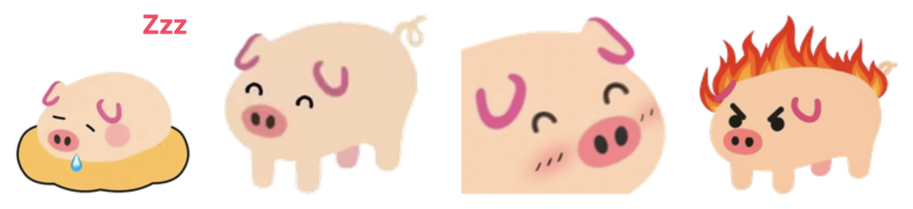
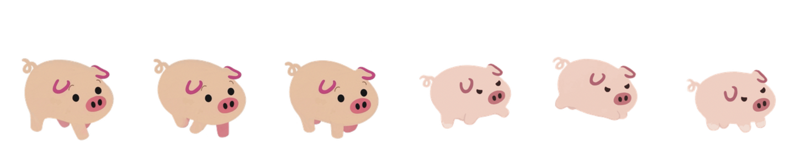

# PiggyPet

A tiny desktop pet for macOS and Windows: sleeps in the corner, turns into random pig memes or Chinese text when clicked, follows your cursor when dragged, and occasionally throws a tiny tantrum that nudges your mouse.

> **Status:** 1.1.1 — macOS and Windows, from one set of assets. 1.1.1 is a one-fix release on top of 1.1.0. Assets are sourced from the community PigHub-DB repository, which does **not** declare a license. They are included for local/personal use only — see [docs/assets-license.md](docs/assets-license.md).

## Screenshots

<p align="center">
  
</p>

<p align="center">
  <sub>Asleep with the breathing Zzz &nbsp;·&nbsp; the face it starts with &nbsp;·&nbsp; what a tap switches to &nbsp;·&nbsp; 发怒</sub>
</p>

<p align="center">
  
</p>

<p align="center">
  <sub>A generated stroll, sampled every 330 ms &nbsp;·&nbsp; then 快跑猪 during an angry chase</sub>
</p>

<p align="center">
  
</p>

<p align="center">
  <sub>Chinese speech bubbles, toggled from the menu</sub>
</p>

These are window captures of the running app — only the pet's own layer, so no desktop, windows or wallpaper are in them. They come from the macOS build; the Windows port draws the same sprites with the same layout, but has not been screenshotted on a real Windows desktop yet.

## Highlights

- Native on both sides — Swift / AppKit on macOS (~100 KB), C# / WinForms on Windows (~130 KB exe). No Electron, no Chromium.
- Borderless transparent floating panel, no Dock icon
- Pixel-accurate click-through: transparent parts of the sprite pass clicks to the app underneath
- Sleep state with a breathing Zzz, tap-to-switch (image or text), drag-to-move, position memory
- Launch at login, enabled on first run and switchable any time from the menu
- App icon generated from the source artwork by `scripts/make_icon.py`
- First launch shows a one-time hint, and 关于 PiggyPet in the menu shows the version and links to the project page
- Re-clamps itself when the display layout changes, so unplugging a monitor never strands it off-screen
- Chinese speech bubbles and a right-click menu to disable the mischievous behavior
- Excitement level (低 / 中 / 高) in the menu controls how often it wanders off on its own
- Automatic activity is mostly a casual stroll; 拱鼠标频率 (从不 / 偶尔 / 经常) sets how often it becomes a cursor nudge instead (default 偶尔, ~20%). Manual 追着鼠标 always nudges.
- 走路速度 (慢悠悠 / 正常 / 利索) sets how fast it ambles. Only an angry chase uses the fast 快跑猪 running animation.
- Every stroll is generated fresh: 3–5 legs of random length (150–310 pt) and random gentle climb, every corner rounded, so the pig walks a different wave each time. It stops wherever the trip ends instead of walking home, and remembers that spot across relaunches.

## Windows (10 / 11, 64-bit)

Grab `PiggyPet-1.1.1-windows-x64.zip` from the [Releases page](https://github.com/Franky100-pig/PiggyPet/releases/latest), unzip it anywhere and double-click `PiggyPet.exe`. Nothing else to install: Windows 10 1903+ and Windows 11 ship with the .NET Framework 4.8 this build targets.

- The same 35 faces, the same generated strolls, the same Chinese right-click menu.
- Cursor nudging uses `SetCursorPos` — no permission prompt, no synthetic clicks.
- 开机自启 writes `HKCU\Software\Microsoft\Windows\CurrentVersion\Run` and can be switched off from the menu at any time.
- The exe is unsigned, so SmartScreen may ask once: **更多信息 → 仍要运行**.
- Settings live in `%APPDATA%\PiggyPet\settings.json`.

`windows/README-Windows.txt` (inside the zip) is the Chinese quick start; [docs/WINDOWS.md](docs/WINDOWS.md) explains how the port maps onto Win32 and what has been verified.

## Download (macOS 13+)

Grab `PiggyPet-1.1.1-universal.zip` from the [Releases page](https://github.com/Franky100-pig/PiggyPet/releases/latest). One zip works on both Apple Silicon and Intel Macs.

1. Unzip and move `PiggyPet.app` to `/Applications` (optional).
2. Remove the download quarantine flag — the app is ad-hoc signed, not notarized:

   ```bash
   xattr -dr com.apple.quarantine /Applications/PiggyPet.app
   ```

   No Terminal? Right-click the app → **Open** → **Open** instead.

3. Double-click to launch. There is no Dock icon: the pig sleeps just above the Dock on the left. Right-click it for the menu.

Check the download against the SHA-256 in `PiggyPet-<version>-checksums.txt`.

## Build & run

macOS:

```bash
./scripts/build.sh     # produces build/PiggyPet.app
./scripts/run.sh       # builds and launches it
```

Requires macOS 13+ and Xcode/Swift. Python 3 + Pillow are only needed to regenerate the sprite assets.

Windows:

```bash
cd windows/PiggyPet.Windows
dotnet build -c Release      # bin/Release/net48/PiggyPet.exe + assets
dotnet run --project ../tests/PiggyPet.LogicTests   # stroll/manifest checks, runs on any OS
```

The .NET SDK 8 can cross-build the net48 exe from macOS or Linux, but the app itself needs Windows to run. GitHub Actions builds and packages it on `windows-latest` (`.github/workflows/windows.yml`).

## Project layout

- `Sources/PiggyPet/` — Swift sources (macOS)
- `windows/` — C# / WinForms sources, manifest of the Windows build, and the logic tests
- `Resources/` — Info.plist template, manifest, icons and processed sprites shared by both builds
- `scripts/` — build/run and asset preparation scripts
- `docs/screenshots/` — the README images, captured from the running app
- `docs/WINDOWS.md` — how the Windows port works and what was verified
- `docs/assets-license.md` — asset provenance and licensing notes

## Changelog

[docs/RELEASE_NOTES.md](docs/RELEASE_NOTES.md) walks through every release; the
[Releases page](https://github.com/Franky100-pig/PiggyPet/releases) has the downloadable
builds and their SHA-256 sums.

## License

Source code is MIT (see [LICENSE](LICENSE)). Pig images are **not** covered by that license.
